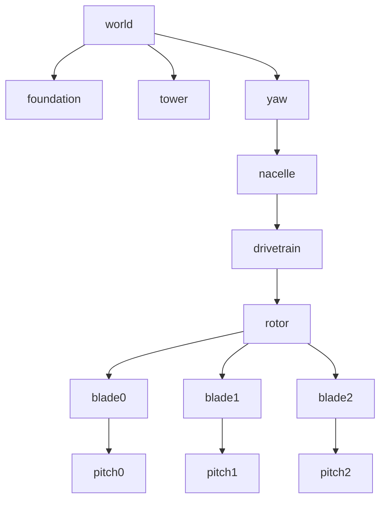
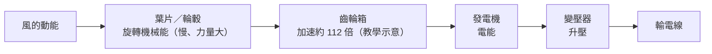

# 零件連接關係與父子群組

> 由 `tools/gen-diagrams.mjs` 依 `src/spec/turbineSpec.js` 自動產生，請勿手動修改。

## 場景圖父子群組

旋轉節點：`yaw`（繞 +Y，偏航角）、`rotor`（繞局部 +Z，從上風看順時針）、`pitch*`（繞葉片局部 +Y，槳距角）。

## 零件連接關係

粗箭頭 = 機械傳動，虛線 = 電力，細箭頭 = 訊號／控制，直線 = 支撐。

```mermaid
graph LR
  foundation["基礎"]:::exterior
  tower["塔架"]:::exterior
  blade["葉片"]:::exterior
  hub["輪轂"]:::exterior
  nacelle["機艙"]:::exterior
  anemometer["風速計"]:::exterior
  windVane["風向標"]:::exterior
  transformer["變壓器"]:::electrical
  powerLine["輸電線"]:::electrical
  mainShaft["主軸（低速軸）"]:::internal
  mainBearing["主軸承"]:::internal
  gearbox["齒輪箱"]:::internal
  highSpeedShaft["高速軸"]:::internal
  brake["煞車"]:::internal
  generator["發電機"]:::internal
  pitchSystem["槳距控制系統"]:::internal
  yawSystem["偏航系統"]:::internal
  controller["控制器"]:::electrical
  powerCable["電力電纜"]:::electrical
  blade ==>|葉片固定在輪轂（經變槳軸承）| hub
  pitchSystem -->|轉動葉片改變槳距| blade
  hub ==>|輪轂帶動主軸（低速）| mainShaft
  mainBearing ---|軸承撐住主軸| mainShaft
  mainShaft ==>|低速輸入| gearbox
  gearbox ==>|加速約 112 倍（教學示意）| highSpeedShaft
  brake -->|必要時煞住| highSpeedShaft
  highSpeedShaft ==>|高速帶動轉子| generator
  generator -.->|電能| powerCable
  powerCable -.->|沿塔架往下| transformer
  transformer -.->|升壓後送出| powerLine
  anemometer -->|風速| controller
  windVane -->|風向| controller
  controller -->|調整槳距| pitchSystem
  controller -->|轉向對風| yawSystem
  controller -->|煞車指令| brake
  yawSystem ==>|轉動整個機艙| nacelle
  nacelle ---|架在塔架頂端（偏航軸承）| tower
  tower ---|固定在基礎上| foundation
  classDef exterior fill:#eef1f4,stroke:#7b8794
  classDef internal fill:#e3f4e8,stroke:#3fae6a
  classDef electrical fill:#fff0e0,stroke:#ff7a1a
```

## 能量轉換路徑

額定時葉輪約 16 rpm × 112 ≈ 1792 rpm（發電機，教學示意）。
